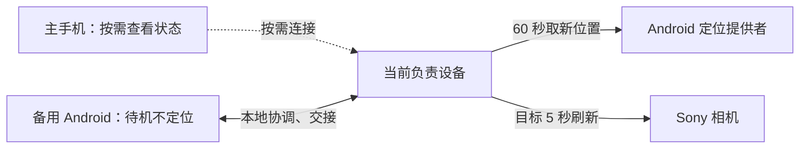

# Android 多设备自动接管方案

日期：2026-11-06。**这是持续 BLE 多设备协作的待实现方案，当前 NFC 试用版不包含持续 BLE 互联和电量 / 在线自动切换。** 不把设计文档或单元测试当作已可用功能。

后续更新：已另行实现 [NFC 手动交接与相机标签](2026-11-06-nfc-handoff.md)，交付 NFC 试用版。本文件中的持续 BLE 协调和电量 / 在线自动切换仍未实现。

用户已确认：都是 Android 手机 / 平板，备用设备能独立定位；希望根据电量和在线状态自动选择给相机发送位置的设备。目标是降低主手机的负担，并优先保证轻量和稳定。

## 分工与使用方式

负责设备同时完成“获取位置 + Sony BLE 位置链接”。其余候选设备不请求定位、不保留相机的 autoConnect GATT，只保持必要的低开销协调通道。主手机可设为最低优先级候选，也可以仅在打开界面时查看状态，完全退出候选和常驻协调。

手机间只交换角色、会话标识、电量、充电和健康状态；各设备自己定位，不需要通过主手机转发坐标。所有候选设备必须分别先在相机上配对，手机之间的互联不能代替 Sony 配对。

Sony α6700 指南说明最多配对 15 个设备，但位置同一时刻只链接一部手机；可同时连接的 Bluetooth 设备数和位置来源数是两个限制。该指南还要求更换位置手机时先关闭旧手机的位置链接。其他机型和固件必须另测，不能假定“两部手机都已连上”就已经完成位置接管。

## 自动选择规则

不根据每 1% 电量变化来回切换。以下只是建议初值，尚未实测或写入当前代码：

| 条件 | 建议行为 |
| --- | --- |
| 当前设备健康、电量充足 | 保持现有负责设备 |
| 当前设备低于 20%，另一台稳定在线且高出至少 20 个百分点 | 准备交接 |
| 有稳定充电的候选设备 | 优先考虑，但仍服从切换冷却期 |
| 候选设备刚上线 | 连续在线约 30 秒后才参与选择 |
| 刚完成切换 | 约 15 分钟内不因普通电量变化再切换 |
| 当前设备失联 / 定位失败 / 相机写入持续失败 | 进入故障判定和接管流程，可绕过普通电量冷却期 |
| 电量未知、定位关闭、权限不足、未配对相机 | 显示原因，不视为健康候选 |

同分时用用户偏好和稳定设备 ID 排序。电量使用系统广播，避免轮询；候选手机在线不能证明它在相机蓝牙范围内，最后仍要以连接和实际写入结果确认。

## 正常交接

1. 当前负责设备选定一个候选，发出有会话编号和超时的准备请求。候选检查配对、权限、系统定位和后台运行资格；必要时短暂获取首个位置，准备超时即停止。
2. 候选就绪后，先对旧设备设置持久的“本组待机”门禁，暂停新增位置包并清理排队包。旧设备释放位置端点、关闭相机 GATT、停止定位，并回报释放结果。
3. 候选在获得当前交接授权后连接相机，重新执行 DD30 → DD31 位置握手，使用自己的有效位置发送。
4. 以位置包的 **GATT 成功回调**确认新负责设备，不能用 `enqueue() == true` 或“BLE 已连接”代替。GATT 成功仍不保证照片 EXIF，界面要准确描述。
5. 候选失败时清理自己的定位 / GATT，由协调流程重新授权旧设备恢复或选择下一候选；不能让旧设备按原 always-on 逻辑自己抢连。每次尝试有上限和退避。

交接可能有短暂空窗。准备阶段可短暂重叠定位，持续发送相机位置的设备仍只有一个；不能承诺无缝或零 GPS 缺失。

## 失联与双主问题

**没有收到手机间状态，不代表原设备已经停止给相机发送。** 两部手机可能只是协调链路断了，相机链路仍正常。单纯“超时就让电量最高的手机连接”会导致争抢。

实现需包含会话代次、唯一交接授权、单调时钟的发送租约、断线退避和重新加入协议。旧设备每次实际发起位置写入前都必须检查授权是否仍有效；进程冻结后恢复也不能依靠过期的定时器继续写。重启时先进入待确认状态，不能直接根据本地旧 owner 标记恢复自动连接。对迟到消息、重复消息和旧会话回调都要做代次检查。

还需要明确租约的授予与续期主体：负责人不能在联系不到其他设备时无限给自己续期。仅有两台设备时，通信分区下不能仅靠心跳同时保证“绝不双主”和“任一设备失联都立即接管”。三台及以上可以评估多数确认，但会增加协调和待机成本；不能因此默认采用常驻全互联网络。

建议先做两台设备的受控电量交接，再在真实机身上验证失联接管：旧设备突然掉电、App 被杀、仅协调蓝牙断开、旧设备恢复、相机仍保留旧链接。确认相机端点的独占 / 拒绝行为后，再启用无人值守的自动失联接管。不能用单元测试宣称相机具有已验证的 fencing 能力。

在上述行为未验证前，失联应显示“负责设备状态未知 / 等待接管条件”，采用保守超时和有限重试；不要高频抢连。最终应说明故障切换的等待时间和可能的空窗，不能给出不存在的 Sony 官方时限。

## 手机间通信与功耗

优先评估本地 BLE，避免云服务和长期维持热点：首次由用户确认加入组，之后保留低频状态通道；重连采用带服务过滤的系统事件或受限扫描窗口，连接后停止扫描。**不安排无限周期扫描，也不把相机的 CDM 关联直接当成手机间发现机制。** Android 文档不推荐周期扫描，CDM 对随机 MAC 和过滤也有限制。

需要验证手机 / 平板的 BLE peripheral 广播和 GATT server 能力、锁屏后的连通性，以及 BLE 与相机链接同时存在时的表现。Android 12+ 会新增 SCAN / ADVERTISE 权限（现有 app 主要使用 CONNECT）；权限只在启用协作时申请，不让单机用户承受功能开销。设备随机地址不能用作长期身份。

后台协调使用适当的 connectedDevice 前台服务。实际接管定位仍须满足 Android 版本对应的位置前台服务和后台定位限制，不能因已有连接权限就跳过。省电豁免和国产系统杀后台也要纳入验证。

“只查看状态”的主手机默认不常驻协调。候选待机时无 GPS，心跳频率和广播 / 重连窗口必须由真实功耗数据决定；BLE 本身也有成本，不能仅因包小就声称完全不耗电。

组内用一次性确认建立信任，密钥存在应用私有存储 / Android Keystore；消息需认证，并包含新鲜随机会话值和递增序号，拒绝重放和冒名电量。初版不需要云账号、位置轨迹上传或自动打开热点。

## 对现有代码的改动边界

| 位置 | 必须接入的行为 |
| --- | --- |
| `LocationSenderService` 的 Connect、ReconnectAlwaysOn | 统一检查负责设备授权；待机不可自动接管 |
| CDM、开机 / 升级恢复、手动连接路径 | 使用同一个门禁，不能从另一个入口绕过待机 |
| `AndroidBleTransport.connect` 和已有 autoConnect handle | 交接时关闭旧 handle，恢复时检查代次；仅调用 `pauseDevice` 不够 |
| `CameraSessionOrchestrator` / 操作队列 / 实际发起写入 | 撤销授权后丢弃排队位置包，恢复回调不能重启旧会话；写入前检查租约 |
| 定位管理器 | 待机停止采样，恢复不沿用上一负责设备的坐标 |
| 通知和设备页面 | 显示本机角色、当前负责设备、电量、交接原因及错误 |
| 日志 | 只在角色 / 健康变化时记录；不按每个心跳写数据库 |

当前 `isTransmitting` 只是全局“队列接受过一个位置包”，不足以作为接管成功判据。应先补每台相机的最后成功写入记录，再实现自动交接。

## 开发顺序与验收

1. 每台相机的诊断状态和统一待机门禁；复用现有单机路径，协作关闭时无额外扫描、广播、定位或计时任务。
2. 两台 Android 的可信组、角色界面和手动受控交接，验证相机端点释放。
3. 加电量 / 充电自动选择、防抖和回退。
4. 验证失联租约与恢复，随后再开放自动故障接管及更多候选设备。

| 场景 | 验收要点 |
| --- | --- |
| 单机模式、相机关闭 8 小时 | 无协作广播 / 扫描，无位置订阅 |
| 两机待机和实际发送各 2 小时 | 分别记录主机、备机耗电，区分总耗电和主手机减负 |
| 两机低电量 / 插拔充电 | 自动交接一次，无 1% 抖动或来回抢连 |
| 全部锁屏 30 分钟以上 | 保持角色、位置新鲜度和可解释的失败状态 |
| 旧机断电、App 被杀、仅 peer 链路断 | 区分真实失效和状态未知，不出现未经授权的双发送 |
| 候选定位关闭、权限撤销、不在相机附近 | 有界失败并恢复可用负责设备，不无限启动定位 |
| 旧机恢复、重启、迟到消息 | 先重新加入，旧 owner / 代次不复活 |
| 相机关开、停止广播、不同 Sony 固件 | 不把广播消失当断开；重复完成有效握手和交接 |
| 交接前后连续拍照 | 核查原始 JPEG / ARW EXIF；不能只看 app 状态 |

真实相机尚未接入，本轮没有实现或完成上述验收。近期可用的减负方式是把相机单独配对给备用 Android，关闭主手机 AlphaGPS 的发送，再由备用设备独立承担定位和 BLE；自动分工仍需开发。

## 参考

- [Sony α6700 位置链接指南](https://helpguide.sony.net/ilc/2320/v1/en/contents/202h_smartphone_location_info.html)
- [Android 后台 BLE](https://developer.android.com/develop/connectivity/bluetooth/ble/background)
- [Android BLE 扫描指导](https://developer.android.com/develop/connectivity/bluetooth/ble/find-ble-devices)
- [Android 蓝牙权限](https://developer.android.com/develop/connectivity/bluetooth/bt-permissions)
